<div align="center">

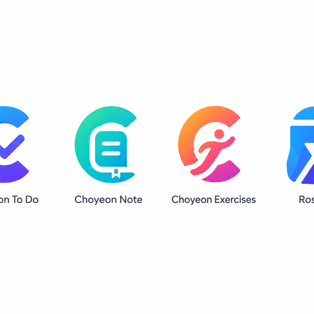

# Choyeon To Do

**轻量级、跨平台的任务管理工具 —— 帮你把事情真正做完。**

[功能特性](#-功能特性) · [界面预览](#-界面预览) · [技术栈](#-技术栈) · [快速开始](#-快速开始) · [项目结构](#-项目结构)

[](https://github.com/Choyeon/choyeon-todo/releases)
[](./LICENSE)
[-blue?style=flat-square)](https://github.com/Choyeon/choyeon-todo/releases)
[](./src/locales)

</div>

---

## 📸 界面预览

> 以下截图均来自真实渲染（已填充示例数据），覆盖桌面端的全部核心页面。

| 任务列表 / 首页 | 四象限矩阵（ Eisenhower ） |
| :---: | :---: |
| 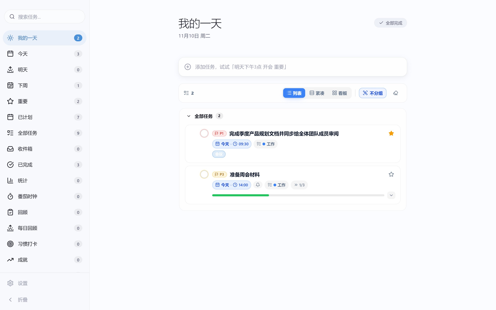 | 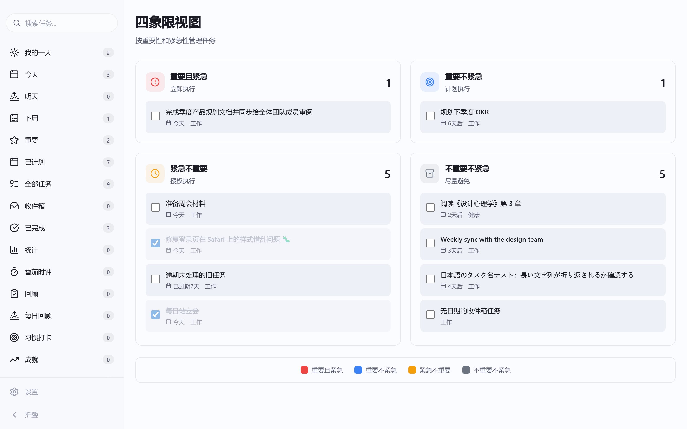 |
| **日历视图** | **数据统计** |
| 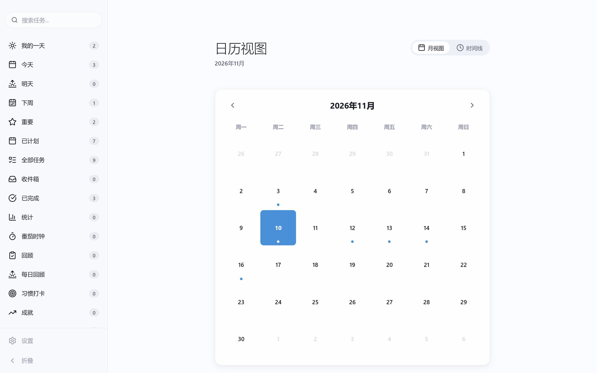 | 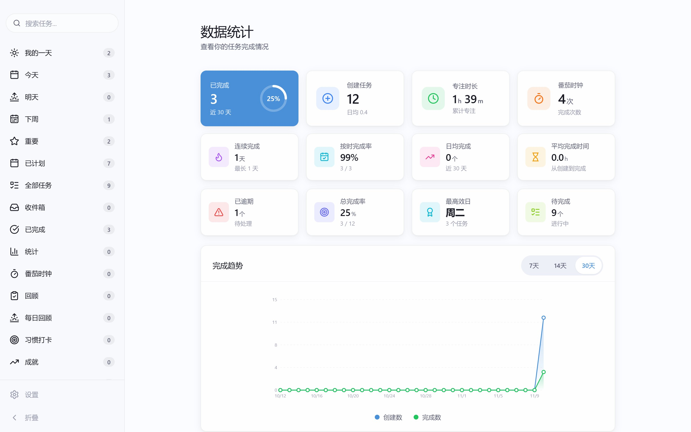 |
| **番茄时钟** | **习惯打卡** |
| 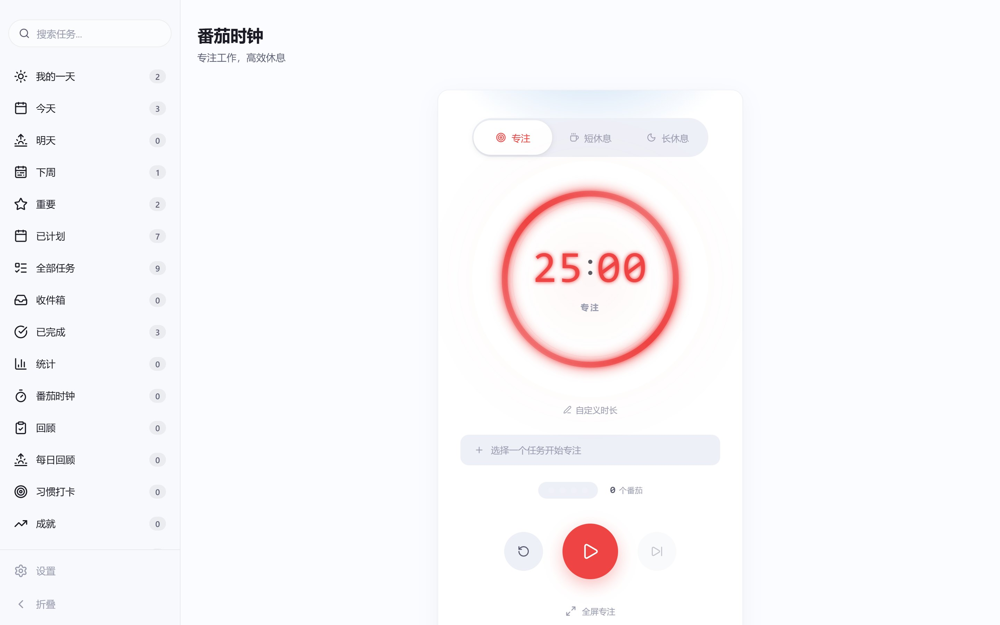 | 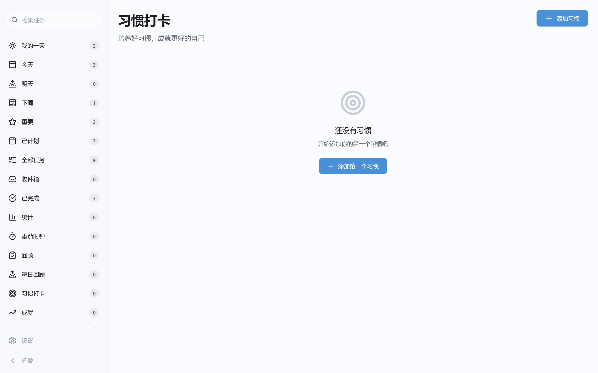 |
| **每日回顾** | **成就系统** |
| 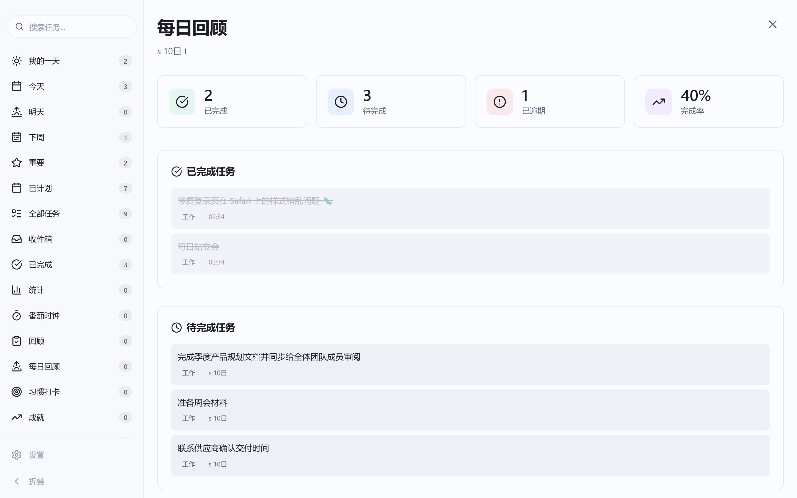 | 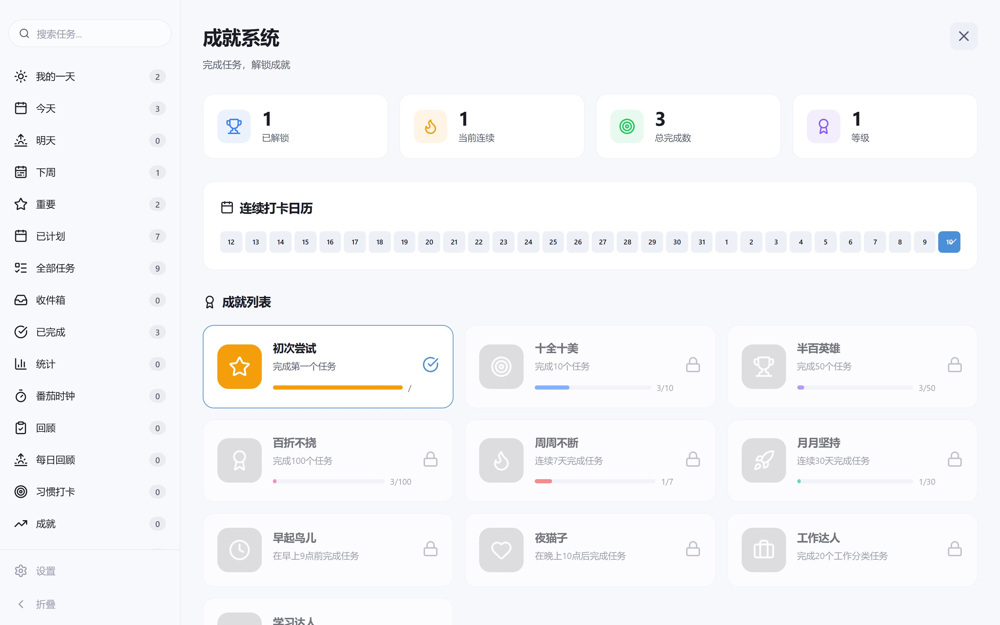 |
| **设置** | **周 / 月回顾** |
| 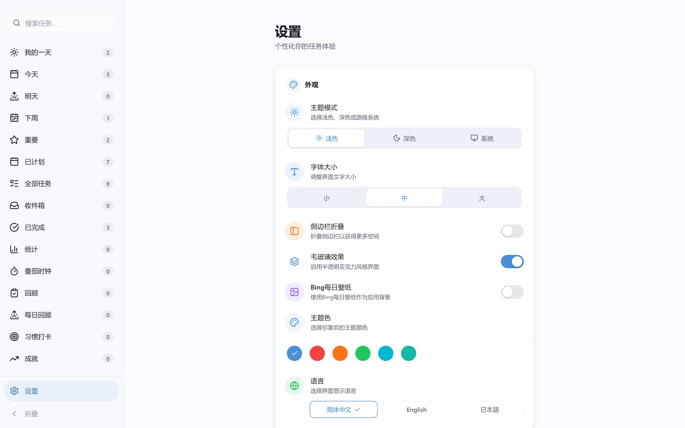 | 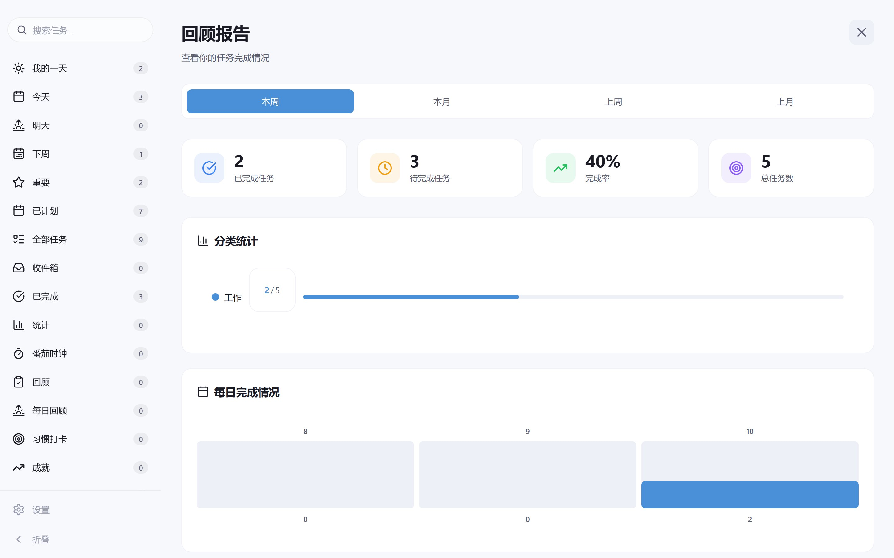 |

### 🌙 深色模式

内置浅色 / 深色 / 跟随系统三套主题，深色模式同样拥有完整的可读性与层次感。

| 深色 · 任务列表 | 深色 · 四象限 |
| :---: | :---: |
| 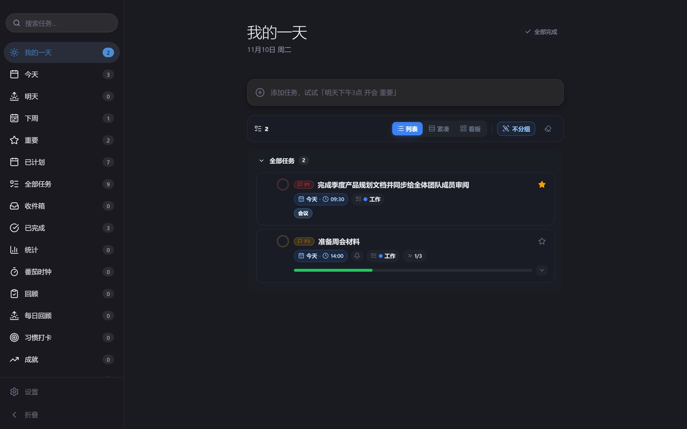 | 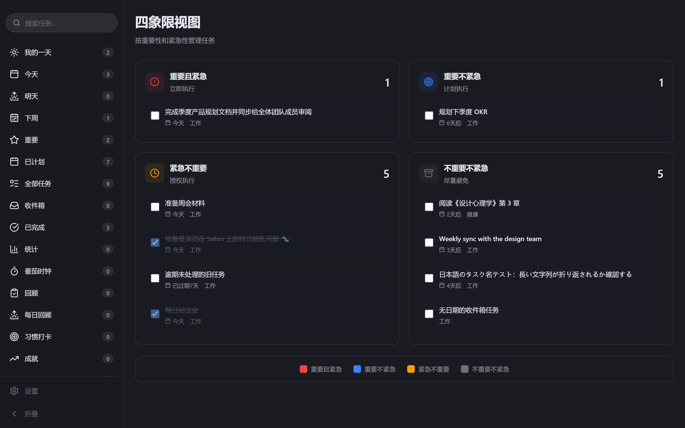 |

---

## ✨ 功能特性

- **智能输入** — 自然语言录入，自动识别日期、优先级与提醒时间
- **四象限管理** — 按「重要 / 紧急」将任务自动归类，聚焦真正要紧的事
- **番茄工作法** — 可配置的专注 / 休息周期，配合桌面通知与悬浮计时
- **日历视图** — 拖拽改期，直观查看每日 / 每周安排
- **数据统计** — 完成趋势、专注时长、按时完成率等多维图表
- **习惯打卡** — 日 / 周循环习惯跟踪，培养长期节奏
- **每日 / 周 / 月回顾** — 周期性复盘，沉淀成就感
- **成就系统** — 任务、专注与连续打卡的可视化激励
- **分类 + 标签 + 自定义筛选** — 灵活组织任务
- **全局快捷键** — 快速新建、搜索、切换视图
- **浅色 / 深色主题** — 跟随系统或手动切换，含主题色自定义
- **本地优先** — 数据存于本地，支持 JSON / CSV 导入导出
- **桌面客户端** — 系统托盘、通知、悬浮小窗（ Windows ）
- **PWA 渐进式应用** — 可安装、可离线
- **国际化** — 简体中文 · English · 日本語

---

## 🧭 页面导览

| 页面 | 作用 |
| :--- | :--- |
| 任务列表（首页） | 今日 / 我的一天 / 全部任务，支持列表、紧凑、看板多种视图与分组 |
| 四象限 | Eisenhower 矩阵，自动按重要紧急划分四个区域 |
| 日历 | 月历视图，拖拽任务改期，逾期 / 当天一目了然 |
| 数据统计 | 完成率、专注时长、完成趋势等图表分析 |
| 番茄时钟 | 专注计时与休息循环，记录每件事的投入 |
| 习惯打卡 | 日常 / 周期习惯跟踪与连续记录 |
| 每日回顾 | 当天任务与专注的轻量复盘 |
| 成就 | 任务、专注、打卡的成就墙 |
| 设置 | 外观、语言、通知、存储等个性化配置 |
| 周 / 月回顾 | 周期性更长视野的总结 |

---

## 🛠 技术栈

| 层 | 技术 |
| :--- | :--- |
| 前端框架 | Vue 3（ `<script setup>` ） + Vite |
| 状态管理 | Pinia |
| 路由 | Vue Router（ hash 模式 ） |
| 桌面端 | Electron（多窗口、托盘、通知、悬浮小窗） |
| 国际化 | vue-i18n（ zh-CN / en-US / ja-JP ） |
| 测试 | Vitest |
| 代码质量 | ESLint + Prettier |
| 渐进式 | vite-plugin-pwa |

---

## 🏁 快速开始

### 环境要求

- Node.js >= 18
- pnpm >= 10

### 安装依赖

```bash
pnpm install
```

### 在浏览器中运行（ Web / PWA ）

```bash
pnpm run dev
```

然后打开 <http://localhost:5173> 。

### 以桌面应用运行（ Windows ）

```bash
pnpm run electron:dev
```

### 构建

```bash
# 仅 Web
pnpm run build

# Windows 桌面安装包
pnpm run electron:build:win
```

预编译安装包可在 [Releases](https://github.com/Choyeon/choyeon-todo/releases) 页面下载。

---

## 🧩 开发脚本

```bash
pnpm run dev           # 启动开发服务器
pnpm run test          # 监听模式运行测试
pnpm run test:run      # 一次性运行全部测试
pnpm run test:coverage # 运行测试并生成覆盖率
pnpm run lint          # ESLint 检查
pnpm run lint:fix      # 自动修复 lint 问题
pnpm run format        # Prettier 格式化
```

---

## 📂 项目结构

```
choyeon-todo/
├── build/             # 应用图标（ PNG + ICO ）
├── electron/          # Electron 主进程 + 预加载脚本
├── public/            # 静态资源
├── scripts/          # 工具脚本（ a11y / i18n / latest.yml 生成 ）
├── src/
│   ├── components/    # 可复用 Vue 组件
│   ├── composables/   # Vue 3 组合式工具
│   ├── i18n/          # 国际化配置
│   ├── locales/       # 多语言文案（ zh / en / ja ）
│   ├── stores/        # Pinia 状态仓库
│   ├── sync/          # 数据同步引擎
│   ├── utils/         # 工具函数
│   ├── views/         # 页面级视图
│   ├── App.vue
│   └── main.js
├── tests/             # Vitest 测试套件
├── package.json
├── pnpm-workspace.yaml
├── vite.config.js
└── vitest.config.js
```

---

## 📜 许可

MIT © Choyeon
